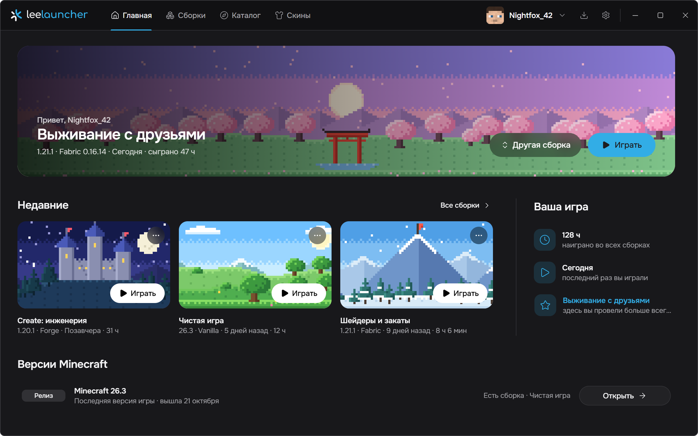
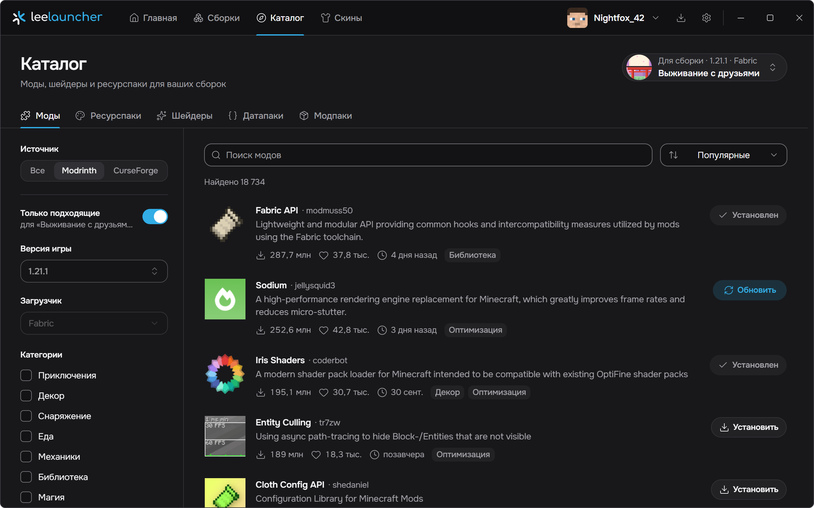
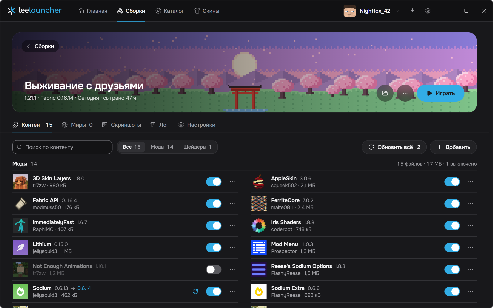
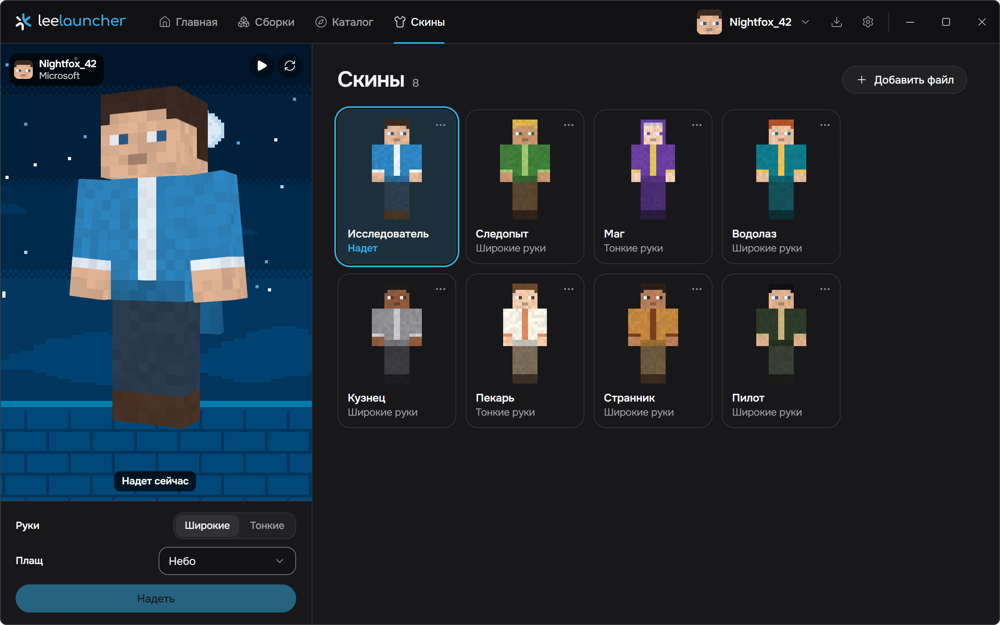
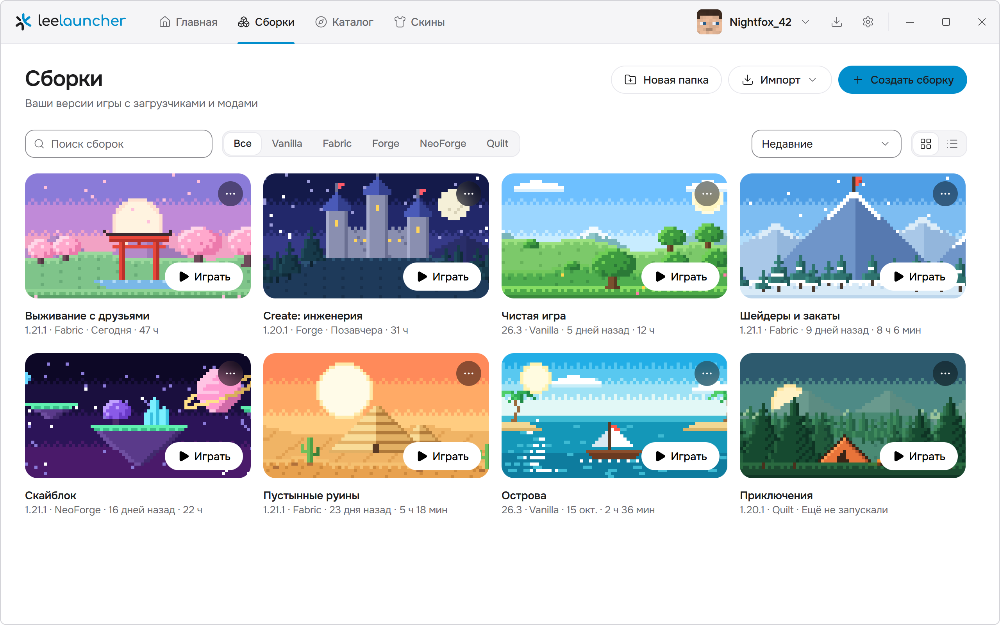

<a href="README.md">Русский</a> · <b>English</b>

  <picture>
    <source media="(prefers-color-scheme: dark)" srcset=".github/assets/logo-dark.svg">
    <source media="(prefers-color-scheme: light)" srcset=".github/assets/logo-light.svg">
    
  </picture>

A Minecraft launcher that makes building your own instances a pleasure

  
  
  
  

  

> The interface is available in English too. Screenshots show the Russian version.

## Features

- **Instances for every taste.** Vanilla, Fabric, Forge, NeoForge and Quilt. Pick a version and the launcher downloads the game, the loader and the right Java for you.
- **Mods from Modrinth and CurseForge.** Mods, shaders, resource packs, data packs and worlds in one catalog. Dependencies install along with the mod, updates take one click.
- **Modpacks.** Install from the catalog or from a `.mrpack` file, update, or roll back to the previous version.
- **Everything about an instance on one page.** Mods, worlds, screenshots, game log and settings: memory, Java, window size.
- **3D skins and capes.** Try on skins from your collection and pick a cape for your Microsoft account.
- **Accounts.** Sign in with Microsoft or just with a nickname, keep several accounts and switch quickly.
- **Keeps itself up to date.** A new launcher version downloads and installs in a couple of clicks, your instances and accounts stay put.
- **Dark and light themes**, Russian and English.
- **No ads, no telemetry.** The launcher sends nothing about you and shows no banners.

## Screenshots

  
  

  
  

## Installation

1. Open the [latest release](https://github.com/leeonttev/LeeLauncher/releases/latest) and download `LeeLauncher-Setup-….exe`.
2. Run it. No administrator rights needed: the launcher installs for your user only.

**The blue “Windows protected your PC” window.** Windows shows it for apps without a paid code signing certificate, and small open source projects usually don’t have one. Click **More info**, then **Run anyway**. The launcher is open source, and the installer is built by GitHub Actions straight from this repository.

The launcher needs WebView2, the Windows component that draws the interface. Windows 11 already has it; if it’s missing, the installer downloads and installs it for you.

## System requirements

- Windows 10 or 11, 64-bit
- An internet connection the first time you launch an instance: the game, the loader and Java are downloaded once

## License

[GPL-3.0](LICENSE). You can use, change and share it, as long as your version stays open under the same license.

Minecraft is a trademark of Mojang Synergies AB. LeeLauncher is not affiliated with or endorsed by Mojang or Microsoft.
