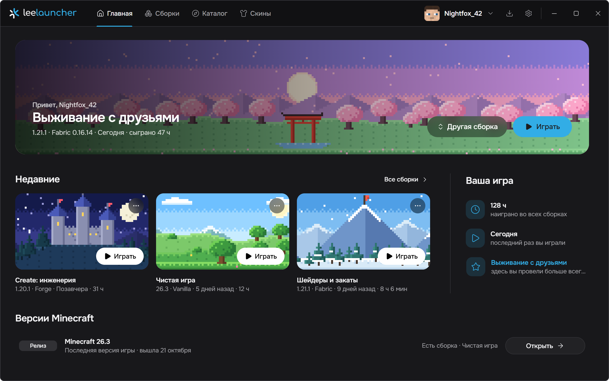
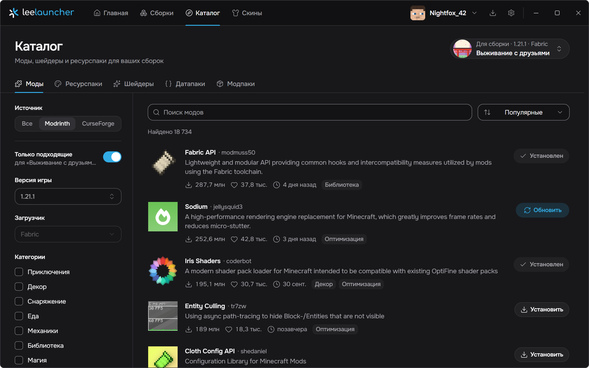
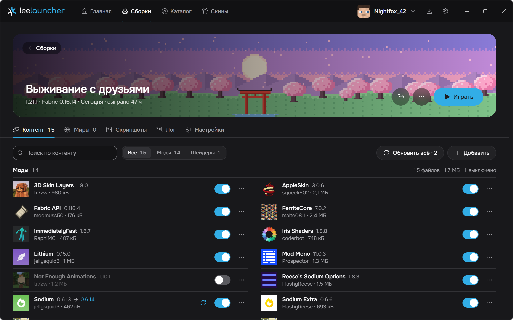
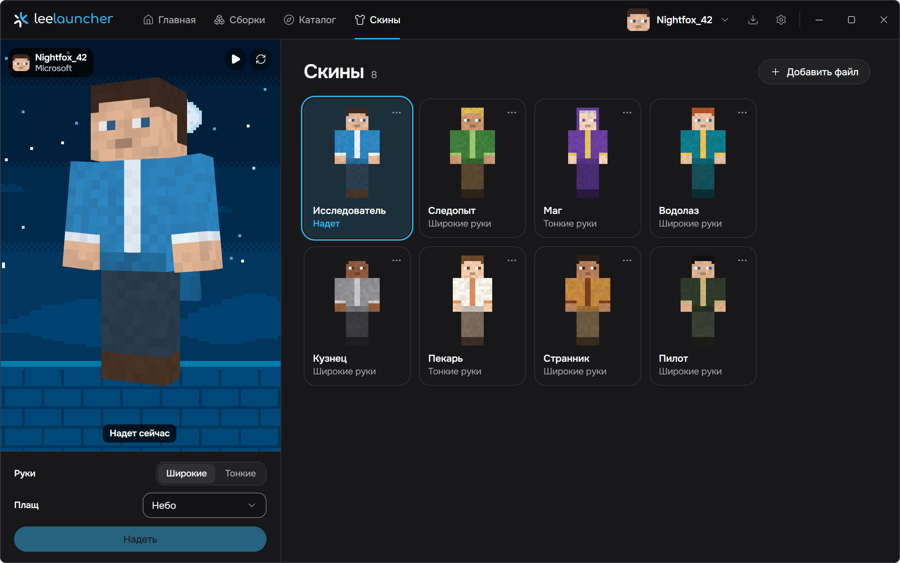
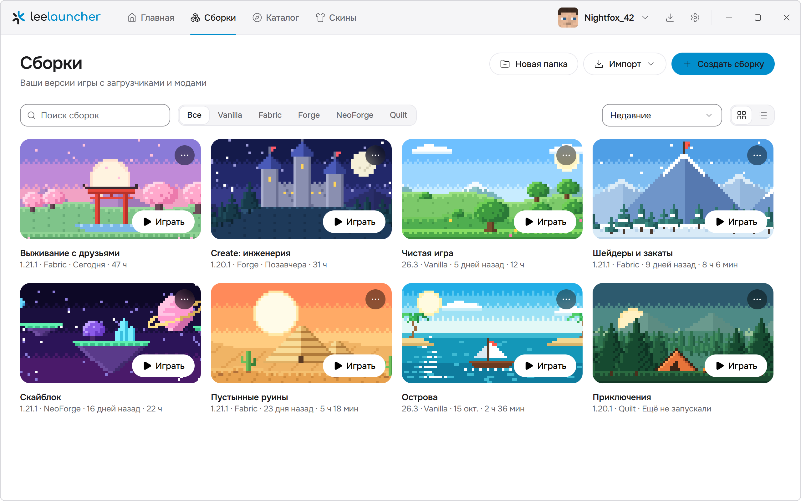

<b>Русский</b> · <a href="README.en.md">English</a>

  <picture>
    <source media="(prefers-color-scheme: dark)" srcset=".github/assets/logo-dark.svg">
    <source media="(prefers-color-scheme: light)" srcset=".github/assets/logo-light.svg">
    
  </picture>

Лаунчер Minecraft, в котором приятно собирать свои сборки

  
  
  
  

  

## Возможности

- **Сборки на любой вкус.** Vanilla, Fabric, Forge, NeoForge и Quilt. Выбираете версию — лаунчер сам скачает игру, загрузчик и нужную Java.
- **Моды из Modrinth и CurseForge.** Моды, шейдеры, ресурспаки, датапаки и миры в одном каталоге. Зависимости ставятся вместе с модом, обновления — одной кнопкой.
- **Модпаки.** Установка из каталога или из файла `.mrpack`, обновление и откат на прошлую версию.
- **Всё о сборке на одной странице.** Моды, миры, скриншоты, лог игры и настройки: память, Java, размер окна.
- **Скины и плащи в 3D.** Примеряйте скины из своей коллекции и выбирайте плащ для аккаунта Microsoft.
- **Аккаунты.** Вход через Microsoft или просто по нику, несколько аккаунтов и быстрое переключение.
- **Сам следит за обновлениями.** Новая версия лаунчера скачивается и ставится в пару щелчков, сборки и аккаунты остаются на месте.
- **Тёмная и светлая темы**, русский и английский языки.
- **Без рекламы и телеметрии.** Лаунчер ничего не отправляет о вас и не показывает баннеров.

## Как это выглядит

  
  

  
  

## Установка

1. Откройте [последний релиз](https://github.com/leeonttev/LeeLauncher/releases/latest) и скачайте файл `LeeLauncher-Setup-….exe`.
2. Запустите его. Права администратора не нужны: лаунчер ставится только для вашего пользователя.

**Синее окно «Windows защитила ваш компьютер».** Так Windows встречает программы без платной цифровой подписи, а у небольших открытых проектов её обычно нет. Нажмите **«Подробнее»**, затем **«Выполнить в любом случае»**. Код лаунчера открыт, установщик собирается на GitHub Actions прямо из этого репозитория.

Для работы нужен WebView2 — компонент Windows, который рисует интерфейс. В Windows 11 он уже есть, а если его нет, установщик скачает и поставит его сам.

## Системные требования

- Windows 10 или 11, 64-бит
- Интернет для первого запуска сборки: игра, загрузчик и Java скачиваются один раз

## Лицензия

[GPL-3.0](LICENSE). Можно пользоваться, изменять и распространять, если ваша версия тоже остаётся открытой под этой лицензией.

Minecraft — торговая марка Mojang Synergies AB. LeeLauncher не связан с Mojang и Microsoft и не одобрен ими.
